## {.q-title}

{.q-logo fig-alt="Askurious"}

[/ɑːˈskjʊə.ri.əs/, from **ask** and **curious**]{.q-ipa}

[Surveys for research: design, field, analyse, share.]{.q-claim}

[Askurious.de · see it live at Askurious.de/s/introduction]{.muted .small}

## The vision {.center}

::: {.q-grid style="--cols: 2;"}
::: {.q-card .big}
[Open source]{.q-h}
Research infrastructure that researchers can inspect, run themselves and build on.
:::
::: {.q-card .big}
[Open data with ease]{.q-h}
From the field to a citable data package in a few clicks: codebook, SPSS, jamovi, R, Zenodo.
:::
::: {.q-card .big}
[Reuse through the toolbox]{.q-h}
Validated scales go in as ordinary items; every study adds to their pooled reliability.
:::
::: {.q-card .big .ai}
[AI where it suits]{.q-h}
Suggestions, never decisions: clearly labelled, reviewed by the researcher, switchable.
:::
:::

## One tool, three kinds of study {.center}

::: {.q-grid style="--cols: 3;"}
::: {.q-card .big}
[Questionnaire]{.q-h}
Online surveys and experiments, from a short pretest to a panel study with quotas.
:::
::: {.q-card .big}
[Live vote]{.q-h}
Live feedback at a lecture or an event, steered by the presenter.
:::
::: {.q-card .big}
[Interview guide]{.q-h}
Qualitative interviews: guide, recording, transcript, coding in a QDA program.
:::
:::

[Same editor, same look, same data protection, same export.]{.small .muted}

## 38 item types, one editor

::: columns
::: {.column .q-side width="32%"}
- **Classic**: choice, free text with validation, date, postal code, ranking, constant sum
- **Scales**: Likert matrix, semantic differential, rating, sliders, Van Westendorp
- **Choice experiments**: CBC, ACBC, MaxDiff
- **Spatial and visual**: image marking, 2D positioning, maps
- **Reaction time**: assignment task, IAT, delay discounting
- **Pre-launch check** and estimated duration while editing
:::
::: {.column width="68%"}
{.q-shot fig-alt="Questionnaire editor"}
:::
:::

## Choice experiments with generative AI

::: columns
::: {.column .q-side width="40%"}
- **CBC, ACBC, MaxDiff** with D-efficient designs, versions and holdout tasks
- **Product images by AI**: one image per combination of attribute levels, so participants choose between what they *see*
- Attributes such as design, locomotion or setting are shown instead of described
- Prompts reviewed by AI before anything is generated
:::
::: {.column width="60%"}
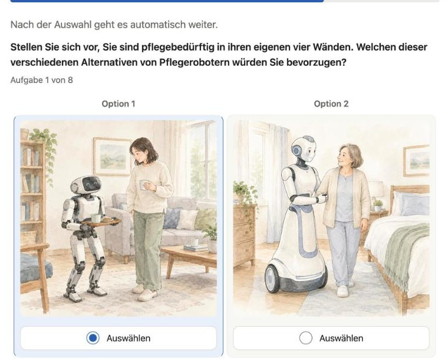{.q-shot .tall fig-alt="Choice task with two AI-generated care robots"}
:::
:::

::: q-refs
Huber & Zwerina (1996) · Louviere, Flynn & Marley (2015)
:::

## Generated, approved, analysed

::: columns
::: {.column width="52%"}
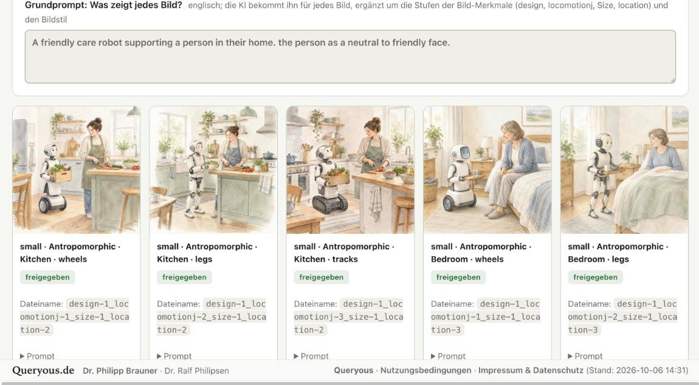{.q-shot fig-alt="46 AI images of a conjoint, one per combination of levels, all approved"}

[46 images, one per combination of the image attributes, each approved by the researcher.]{.q-caption}
:::
::: {.column width="48%"}
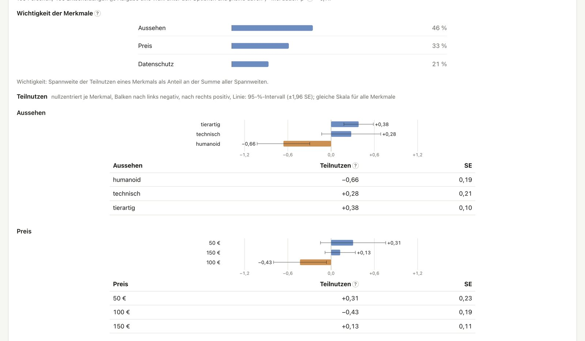{.q-shot fig-alt="Importance and part-worth utilities"}

[Importance and part-worths with intervals; individual utilities by hierarchical Bayes, segments by latent class, market simulator.]{.q-caption}
:::
:::

::: q-refs
Allenby & Rossi (1998) · Orme (2010)
:::

## Loops and vignettes

::: columns
::: {.column .q-side width="32%"}
- **Loops**: one block, many variants from a table, like a mail merge
- Placeholders in texts and AI images, order randomised per person
- **Factorial surveys**: factors and levels instead of a typed table
- **D-optimal designs** by coordinate exchange, split into balanced decks
:::
::: {.column width="68%"}
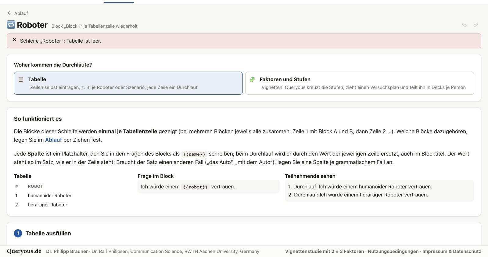{.q-shot fig-alt="Loop page with table and placeholders"}
:::
:::

::: q-refs
Brauner (2024) · Meyer & Nachtsheim (1995) · Atzmüller & Steiner (2010) · Auspurg & Hinz (2015)
:::

## Blocks, branches, piping

::: columns
::: {.column .q-side width="32%"}
- **Flow**: blocks, randomisers with balanced assignment, conditions, ends of different kinds
- **External sections**, e.g. a web experiment in the middle of the survey
- **Piping**: earlier answers in later texts, options carried forward, computed values
- Statements and options **shown to some**, loops for within-subject designs
:::
::: {.column width="68%"}
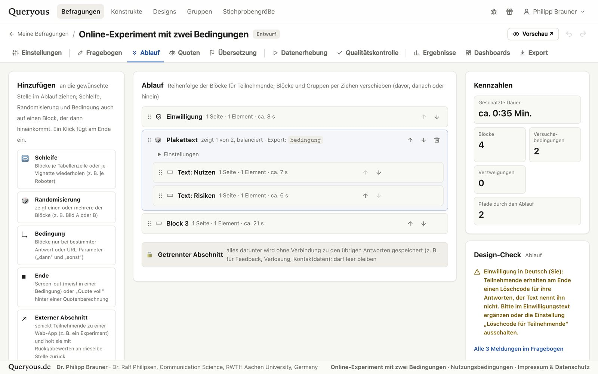{.q-shot fig-alt="Flow page with randomiser"}
:::
:::

## Lots of options, sensible defaults

::: columns
::: {.column width="50%"}
- Answer modes: **optional**, **nudge** (point out once) or **required**
- "Don't know", "other" with text, reversed items
- Randomised statements and options
- Auto-advance, dropdowns, maps, one-click answers
- Multilingual, with AI translation of what is open
:::
::: {.column width="50%"}
- **Tempo hint** for pages sent too fast
- Attention checks inside matrices
- Undo and redo, trash, snapshots before changes
- Pre-launch check before the start: what is missing, what is risky
- Estimated completion time
:::
:::

::: q-refs
Krosnick & Presser (2010) · Conrad, Tourangeau, Couper & Zhang (2017) · Gummer, Roßmann & Silber (2021)
:::

## Live feedback to each participant

::: columns
::: {.column .q-side width="46%"}
- **Own position on a scale**, explained in words
- **Comparison with the current sample**: as a crowd of figures, a bell curve, a distribution or a 2D map
- **Score bands**: own categories, by value or percentile rank
- **IAT result** in words

::: q-quote
Participants who get feedback on their answers are more satisfied with the survey.
:::
:::
::: {.column width="54%"}
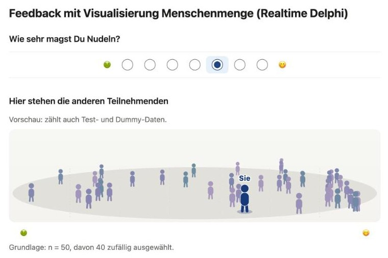{.q-shot fig-alt="The participant as a figure in the crowd of earlier participants"}
:::
:::

::: q-refs
Kühne & Kroh (2018)
:::

## Preview and feedback on the survey

::: columns
::: {.column .q-side width="32%"}
- **Desktop and smartphone** preview, device sizes to choose
- **QR code**: test on a real phone, without signing in
- **Comment fields** per page or question, with a screenshot; handled and exported
- **Pretest links** for testers without an account
- **AI wording review** against the rules of questionnaire design
:::
::: {.column width="68%"}
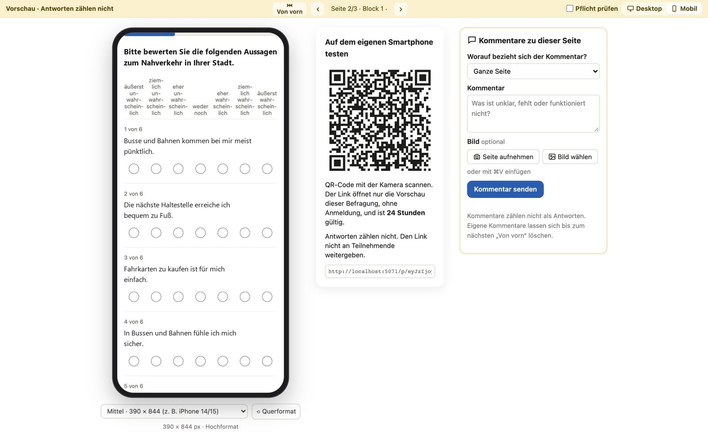{.q-shot fig-alt="Preview with smartphone frame, QR code and comment panel"}
:::
:::

## Separated section and privacy

::: columns
::: {.column width="50%"}
[Separated section]{.q-h}

- Contact details collected **after** the survey, stored **apart** from the answers
- For raffles, incentives, interview invitations
- Cannot be linked back to a participation
:::
::: {.column width="50%"}
[Privacy by design]{.q-h}

- Informed consent with an assistant
- **Deletion codes**: withdraw later, without an account
- **Retention periods** per survey
- Transcription on the institute's own Whisper server
- ORCID, two-factor authentication, audit log
:::
:::

::: q-refs
Deutsche Forschungsgemeinschaft (2019)
:::

## Into the field

::: columns
::: {.column .q-side width="32%"}
- **Panel links**: URL parameters, redirects for completed, screen-out, quota full
- **Quota control** with an assistant based on official population figures (census 2022), weighting by raking
- **Links per group**, e.g. student groups, with counts; short links and QR codes
- **Field time and deadline**, sample size calculator
:::
::: {.column width="68%"}
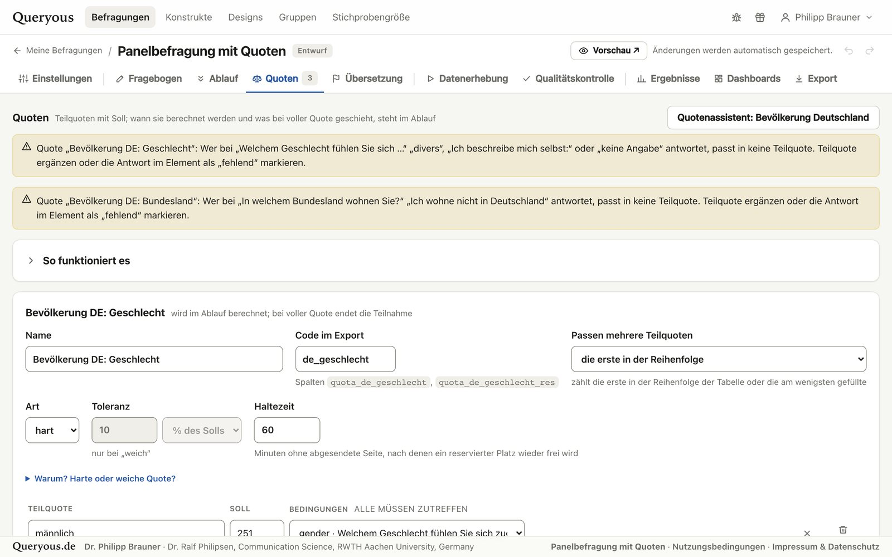{.q-shot fig-alt="Quota page"}
:::
:::

::: q-refs
Baker et al. (2013)
:::

## One look across all surveys

::: columns
::: {.column .q-side width="40%"}
- **Designs**: colours, font and logos for the participant pages
- Saved once, shared with the whole team or group
- **Image styles**: one style for all AI images of a survey, from ink and watercolour to documentary photo
- Each generated image is approved before it is shown
:::
::: {.column width="60%"}
{.q-shot fig-alt="Selector of the image style for all AI images of a survey"}
:::
:::

## Live data view

::: columns
::: {.column .q-side width="34%"}
- **M, SD, median**, frequencies while the survey runs
- **Cronbach's α and McDonald's ω** per scale and subscale, with 95 % intervals
- Correlations of the scales, as a table for manuscripts
- Group comparisons, **dashboards** for people without an account
:::
::: {.column width="66%"}
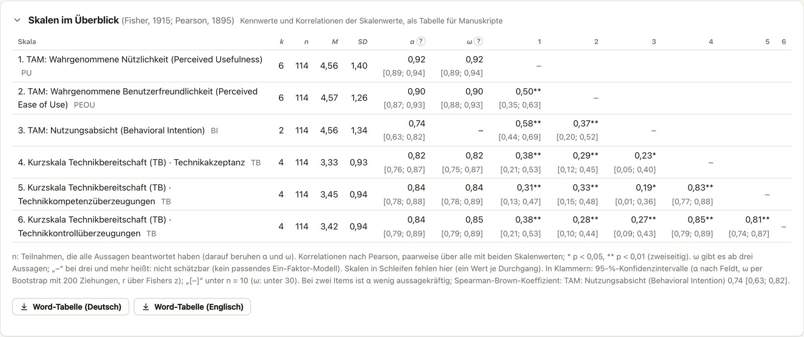{.q-shot fig-alt="Scales overview with alpha, omega and correlations"}
:::
:::

::: q-refs
Cronbach (1951) · McDonald (1999) · Hayes & Coutts (2020) · Feldt, Woodruff & Salih (1987)
:::

## Hypotheses and quality control

::: columns
::: {.column width="50%"}
{.q-shot fig-alt="Results per hypothesis of the study plan"}

[Each hypothesis of the study plan tested as planned, with the sentence for the report.]{.q-caption}
:::
::: {.column width="50%"}
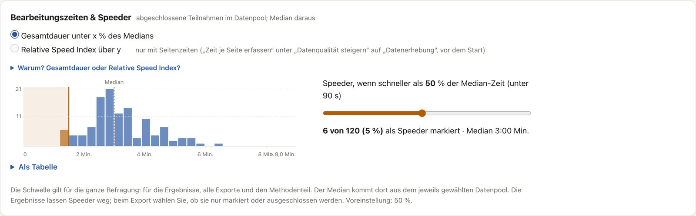{.q-shot fig-alt="Speeder threshold on the completion times"}

[Speeders, straightlining, failed attention checks, bots, AI agents: marked, never silently removed.]{.q-caption}
:::
:::

::: q-refs
Leiner (2019) · Curran (2016) · Meade & Craig (2012) · Höhne, Claassen & Wolf (2025)
:::

## Open data with ease

::: columns
::: {.column .q-side width="32%"}
- **Export**: CSV, SPSS and JASP (.sav), jamovi (.omv), R (.rds), codebook, questionnaire as Word
- **Publish**: data package as a draft on Zenodo, archive in Coscine
- **Write up**: pre-registration snapshot, APA tables, a draft of the methods section from the survey's own figures
:::
::: {.column width="68%"}
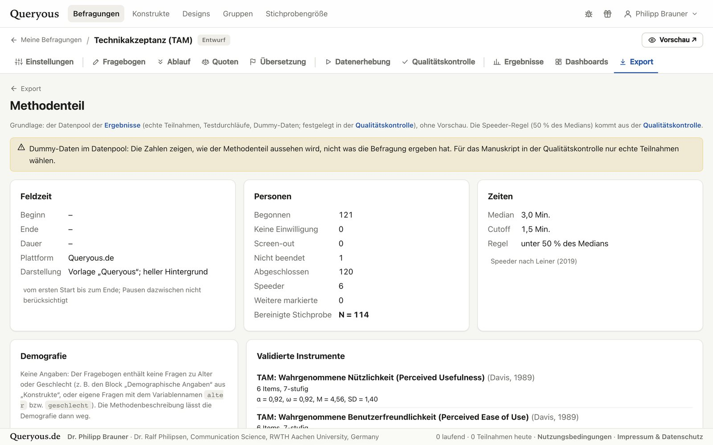{.q-shot fig-alt="Methods section drafted from the survey"}
:::
:::

## The construct toolbox

::: columns
::: {.column .q-side width="32%"}
- Validated instruments, found by full-text search and facets
- Inserted as ordinary items, with their sources
- Every study adds to the **pooled reliability** of a scale (meta-analysis across studies)
- The same question **linked** across surveys

::: q-quote
Every survey makes the next one better.
:::
:::
::: {.column width="68%"}
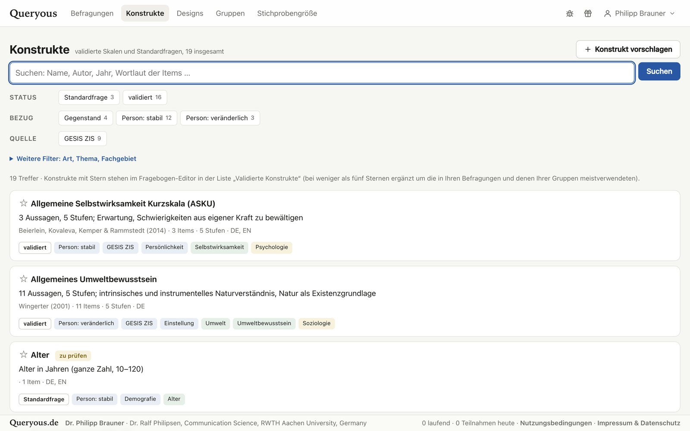{.q-shot fig-alt="Construct toolbox"}
:::
:::

::: q-refs
DerSimonian & Laird (1986) · Bonett (2002)
:::

## Live votes in the lecture hall {.center}

::: columns
::: {.column width="55%"}
- The presenter steers: one question at a time, results on the big screen
- Participants join by QR code on their phones
- Same item types and the same look as the questionnaires
- AI assistant suggests feedback questions for the event
:::
::: {.column width="45%"}
::: q-card
[For teaching and events]{.q-h}
Check what a lecture got across, collect questions, poll the audience, with the data in the same place as the research.
:::
:::
:::

## Qualitative surveys

::: {.q-grid style="--cols: 4;"}
::: {.q-card .big}
[Guide]{.q-h}
Narrative prompts with aspects, follow-up and specific questions
:::
::: {.q-card .big}
[Record]{.q-h}
In person or remote, with consent
:::
::: {.q-card .big}
[Transcribe]{.q-h}
On the institute's own Whisper server
:::
::: {.q-card .big .ai}
[Summarise]{.q-h}
AI summaries per interview, search across interviews
:::
:::

[Export as **REFI-QDA (.qdpx)** for MAXQDA, ATLAS.ti, NVivo and QDA Miner, with the category system from the guide.]{.small}

::: q-refs
Helfferich (2011) · Kuckartz & Rädiker (2022) · REFI-QDA (2019)
:::

## For students and newcomers {.center}

::: {.q-grid style="--cols: 3;"}
::: {.q-card .big}
[Learning aids]{.q-h}
Short reasons at every decision, reading aids at every statistic, a glossary
:::
::: {.q-card .big}
[Study templates]{.q-h}
Six typical studies with study plan, questionnaire and dummy data to start from
:::
::: {.q-card .big .ai}
[AInstein]{.q-h}
A research assistant for the time before the survey: from a rough idea to a study plan
:::
:::

## References (1/2)

::: q-reflist
Allenby, G. M., & Rossi, P. E. (1998). Marketing models of consumer heterogeneity. *Journal of Econometrics, 89*(1–2), 57–78. https://doi.org/10.1016/S0304-4076(98)00055-4

Atzmüller, C., & Steiner, P. M. (2010). Experimental vignette studies in survey research. *Methodology, 6*(3), 128–138. https://doi.org/10.1027/1614-2241/a000014

Auspurg, K., & Hinz, T. (2015). *Factorial survey experiments* (Quantitative Applications in the Social Sciences, Vol. 175). Sage. https://doi.org/10.4135/9781483398075

Baker, R., Brick, J. M., Bates, N. A., Battaglia, M., Couper, M. P., Dever, J. A., Gile, K. J., & Tourangeau, R. (2013). Summary report of the AAPOR Task Force on Non-probability Sampling. *Journal of Survey Statistics and Methodology, 1*(2), 90–143. https://doi.org/10.1093/jssam/smt008

Bonett, D. G. (2002). Sample size requirements for testing and estimating coefficient alpha. *Journal of Educational and Behavioral Statistics, 27*(4), 335–340. https://doi.org/10.3102/10769986027004335

Brauner, P. (2024). Mapping acceptance: Micro scenarios as a dual-perspective approach for assessing public opinion and individual differences in technology perception. *Frontiers in Psychology, 15*, 1419564. https://doi.org/10.3389/fpsyg.2024.1419564

Conrad, F. G., Tourangeau, R., Couper, M. P., & Zhang, C. (2017). Reducing speeding in web surveys by providing immediate feedback. *Survey Research Methods, 11*(1), 45–61. https://doi.org/10.18148/srm/2017.v11i1.6304

Cronbach, L. J. (1951). Coefficient alpha and the internal structure of tests. *Psychometrika, 16*(3), 297–334. https://doi.org/10.1007/BF02310555

Curran, P. G. (2016). Methods for the detection of carelessly invalid responses in survey data. *Journal of Experimental Social Psychology, 66*, 4–19. https://doi.org/10.1016/j.jesp.2015.07.006

DerSimonian, R., & Laird, N. (1986). Meta-analysis in clinical trials. *Controlled Clinical Trials, 7*(3), 177–188. https://doi.org/10.1016/0197-2456(86)90046-2

Deutsche Forschungsgemeinschaft. (2019). *Leitlinien zur Sicherung guter wissenschaftlicher Praxis: Kodex* (Leitlinie 17: Archivierung). https://doi.org/10.5281/zenodo.3923602

Feldt, L. S., Woodruff, D. J., & Salih, F. A. (1987). Statistical inference for coefficient alpha. *Applied Psychological Measurement, 11*(1), 93–103. https://doi.org/10.1177/014662168701100107

Gummer, T., Roßmann, J., & Silber, H. (2021). Using instructed response items as attention checks in web surveys: Properties and implementation. *Sociological Methods & Research, 50*(1), 238–264. https://doi.org/10.1177/0049124118769083
:::

## References (2/2)

::: q-reflist
Hayes, A. F., & Coutts, J. J. (2020). Use omega rather than Cronbach's alpha for estimating reliability. But…. *Communication Methods and Measures, 14*(1), 1–24. https://doi.org/10.1080/19312458.2020.1718629

Helfferich, C. (2011). *Die Qualität qualitativer Daten: Manual für die Durchführung qualitativer Interviews* (4. Aufl.). VS Verlag für Sozialwissenschaften. https://doi.org/10.1007/978-3-531-92076-4

Höhne, J. K., Claassen, J., & Wolf, B. L. (2025). LLM-driven bot infiltration: Protecting web surveys through prompt injections. *International Journal of Social Research Methodology*. https://doi.org/10.1080/13645579.2025.2598606

Huber, J., & Zwerina, K. (1996). The importance of utility balance in efficient choice designs. *Journal of Marketing Research, 33*(3), 307–317. https://doi.org/10.1177/002224379603300305

Krosnick, J. A., & Presser, S. (2010). Question and questionnaire design. In P. V. Marsden & J. D. Wright (Eds.), *Handbook of survey research* (2nd ed., pp. 263–313). Emerald.

Kuckartz, U., & Rädiker, S. (2022). *Qualitative Inhaltsanalyse: Methoden, Praxis, Computerunterstützung* (5. Aufl.). Beltz Juventa.

Kühne, S., & Kroh, M. (2018). Personalized feedback in web surveys: Does it affect respondents' motivation and data quality? *Social Science Computer Review, 36*(6), 744–755. https://doi.org/10.1177/0894439316673604

Leiner, D. J. (2019). Too fast, too straight, too weird: Non-reactive indicators for meaningless data in internet surveys. *Survey Research Methods, 13*(3), 229–248. https://doi.org/10.18148/srm/2019.v13i3.7403

Louviere, J. J., Flynn, T. N., & Marley, A. A. J. (2015). *Best-worst scaling: Theory, methods and applications*. Cambridge University Press. https://doi.org/10.1017/CBO9781107337855

McDonald, R. P. (1999). *Test theory: A unified treatment*. Lawrence Erlbaum Associates.

Meade, A. W., & Craig, S. B. (2012). Identifying careless responses in survey data. *Psychological Methods, 17*(3), 437–455. https://doi.org/10.1037/a0028085

Meyer, R. K., & Nachtsheim, C. J. (1995). The coordinate-exchange algorithm for constructing exact optimal experimental designs. *Technometrics, 37*(1), 60–69. https://doi.org/10.1080/00401706.1995.10485889

Orme, B. K. (2010). *Getting started with conjoint analysis: Strategies for product design and pricing research* (2nd ed.). Research Publishers.

REFI-QDA. (2019). *REFI-QDA Project Exchange Standard* (Version 1.0). Rotterdam Exchange Format Initiative. https://www.qdasoftware.org
:::

## {.q-title}

{.q-logo fig-alt="Askurious"}

[Open source · open data · reusable · AI where it suits]{.q-claim}

[Askurious.de · Askurious.de/s/introduction]{.muted .small}
